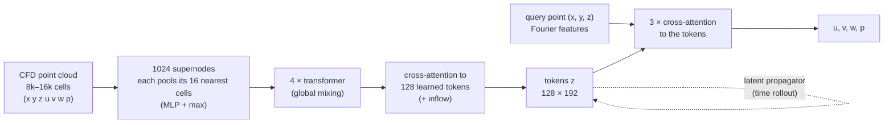
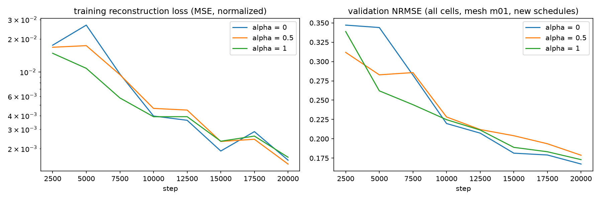
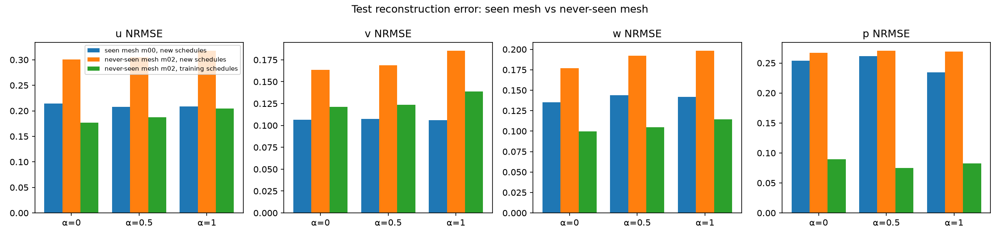
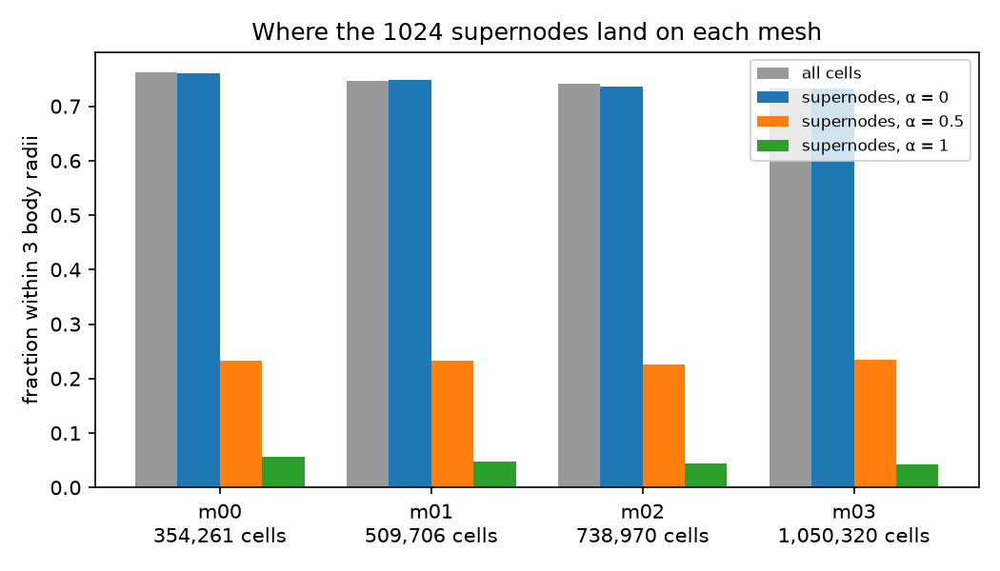

# HW3

**In short:**

| | HW2 model (baseline) | HW3 model |
|---|---|---|
| **Task** | steady flow, one snapshot per case | transient flow over 550 ms with changing inflow, plus rollout from one CFD snapshot |
| **Encoder** | each point pools its 16 nearest neighbours (edge-MLP + max), then **one max-pool over all points → a single 128-number vector** | **1,024 supernodes** each pool their 16 nearest cells (MLP + max) → **4 transformer layers** → **cross-attention into 128 learned tokens** (128 × 192), conditioned on the inflow |
| **Decoder** | **SIREN**: 5 sine-activation layers × 256, input = (x, y, z) + the vector | **Fourier features** of (x, y, z) → **3 cross-attention layers** to the 128 tokens → u, v, w, p |
| **Target** | residual vs a fixed freestream (34.3 m/s) | residual vs the **time-varying inflow**, scaled per field |
| **Losses** | reconstruction + consistency | reconstruction + **sampling invariance** + **mesh consistency** (on layer-normed tokens) |
| **Time stepping** | none | **latent propagator**: a transformer that steps the 128 tokens forward 5 ms at a time |

- **Design 1, HW2 → HW3:** I replaced the single global vector and SIREN with the token encoder and attention decoder above, and tested it on a new transient dataset (24 inflow schedules × 4 meshes). A controlled ablation (1 token vs 128) showed that, surprisingly, **1 token was as good for velocity**. The other changes mattered more.
- **Design 2:** I attacked the model's remaining weakness, a ~3× higher error on a never-seen mesh, with **density-tempered supernode sampling**. It made predictions more mesh-consistent but did not reduce the error. The analysis shows why: on the unseen mesh, the **CFD itself** differs.

---

## 1. Task and dataset

**Task.** Predict the 3D airflow around an ellipsoid: velocity (u, v, w) and pressure p at any point. The input is an OpenFOAM solution given as a point cloud. The model has to work no matter which mesh produced that point cloud.

**Dataset B** (OpenFOAM on UVA Rivanna; generation code in `code/cfd/`; the data is not uploaded):

| | |
|---|---|
| Geometry | ellipsoid, semi-axes 0.20 × 0.50 × 0.15 m, in a 4 × 9 × 4 m domain |
| Flow | transient `pimpleFoam`, 550 ms per run, 111 snapshots, 5 ms apart |
| Inflow schedules | 24 randomized schedules in 6 families: ramp, speed sine, yaw step, yaw sine, gust, combined. Speed 25–47 m/s, yaw ±15° |
| Meshes | 4 `snappyHexMesh` meshes, m00–m03, with 354k / 510k / 739k / 1.05M cells |
| Total | 96 runs. **Mesh m02 is never used for training** |

**Metric:** NRMSE = RMSE / std(CFD field), per field, computed on **every cell** of the native mesh. 1.0 means no better than predicting the mean.

---

## 2. Baseline: my HW2 model (Phase A)

HW2's model compressed the entire flow into **one 128-number vector**:
- **Encoder:** each input point is described by an MLP over its 16 nearest neighbours, then a max-pool over **all** points gives one global vector.
- **Decoder:** a SIREN (5 × 256, sine activations) maps (x, y, z, vector) to u, v, w, p.

HW2's main limitation, as reported: *it captured broad flow patterns but smoothed near-body gradients and wake structures.*

## 3. New design

**Hypothesis.** A single global vector is an information bottleneck. Every query point is decoded from the same 128 numbers, so local detail (boundary layer, wake edges) gets averaged away. **Keeping many local tokens that each query point can attend to should remove that bottleneck.**



| Design choice | HW2 | v2 | Why |
|---|---|---|---|
| Flow summary | 1 vector × 128 | **128 tokens × 192** | remove the global bottleneck |
| Encoder | per-point kNN MLP → max over all points | **1,024 supernodes** (kNN pooling) → transformer → cross-attention | local detail first, then global mixing; output size independent of the mesh |
| Decoder | SIREN | **Fourier features + cross-attention** to the tokens | each point looks up the tokens relevant to it |
| Target | residual vs a fixed freestream | residual vs the **time-varying inflow**, per-field scaling | the network only learns what the body does to the flow |
| Losses | reconstruction + consistency | reconstruction + **sampling invariance** + **mesh consistency** (on layer-normed tokens) | the same flow should give the same tokens whatever the sampling or mesh |
| Time | steady | **latent propagator** (transformer stepping the tokens 5 ms) | rollout from one CFD snapshot |

**Training (autoencoder):** AdamW, lr 3e-4, 1k warmup then cosine decay, batch 4, mixed precision, one A100.

$$\mathcal{L} = \mathrm{MSE}(\hat r, r) + 0.1\,\mathrm{MSE}(\mathrm{LN}(z_A), \mathrm{LN}(z_B)) + 0.1\,\mathrm{MSE}(\mathrm{LN}(z_{m_i}), \mathrm{LN}(z_{m_j}))$$

### Result: full training (150k steps, all training runs)

| Reconstruction NRMSE, 3 unseen schedules | u | v | w | p |
|---|---|---|---|---|
| training meshes m00/m01/m03 | 0.046 | 0.030 | 0.026 | 0.072 |
| **never-seen mesh m02** | **0.109** | **0.103** | **0.065** | **0.107** |
| ratio | 2.4× | 3.4× | 2.5× | 1.5× |

Rolling out 110 steps from a single snapshot with the propagator, on unseen schedules and training meshes, gives u 0.070, v 0.032, w 0.031, p 0.138. **The design works on new inflow schedules, but a new mesh is still ~3× worse.**

### Controlled ablation: 1 token vs 128 tokens
This is the same v2 code, data, split and budget (20k steps, see §5). The only change is `model.n_latent`. With 1 token, v2 has HW2's single-vector bottleneck.

Test reconstruction NRMSE (u / v / w / p). The s11 yaw step is shown separately because it fails for *every* model (see below):

| Test runs | **1 token** | **128 tokens** |
|---|---|---|
| seen mesh m00: s03 ramp + s19 gust | 0.040 / 0.032 / 0.032 / 0.085 | 0.041 / 0.033 / 0.032 / **0.073** |
| never-seen m02: s03 ramp + s19 gust | 0.150 / 0.110 / 0.090 / 0.093 | 0.159 / 0.106 / 0.090 / **0.081** |
| never-seen m02: 3 training schedules | 0.157 / 0.112 / 0.091 / 0.096 | 0.177 / 0.121 / 0.100 / **0.089** |
| s11 yaw step, m00 / m02 (u) | 0.558 / 0.584 | 0.563 / 0.584 |
| best val NRMSE · training time | 0.1686 · 26.7 min | 0.1674 · 27.3 min |

**Result: the bottleneck hypothesis is not supported at this scale.** With the rest of v2 kept (supernode encoder, transformer, Fourier + attention decoder), **one 192-number token reconstructs velocity as well as 128 tokens**. Only pressure benefits from more tokens, by about 13% (0.073 vs 0.085 on m00, 0.081 vs 0.093 on m02). So HW2's smoothing was probably not caused by the single vector itself, but by the rest of HW2's pipeline: max-pooling all points at once, the SIREN decoder, no Fourier features, much less data. A single 20k-step run per setting can't separate those; that would take one ablation per component. With one seed and differences of a few percent, the velocity numbers should be read as "no clear difference".

**Unexpected: s11 yaw step fails for every model**, on the seen mesh too (u ≈ 0.56). The reduced training set has only one yaw-step schedule (s08), and s11 is a yaw step the model hasn't learned to extrapolate to. Even the fully trained model had its largest m02 error on s11 (u 0.198). This one schedule dominates the group averages in §6.

---

## 4. Remaining weakness and my second design: density-tempered supernodes

**Observation.** On m02, the never-seen mesh, v2 is about 2.5–3.4× worse for velocity.

**Hypothesis.** The encoder picks its 1,024 supernodes **uniformly at random from the input cells**, so each mesh's refinement pattern decides where the encoder looks. A new mesh changes the sampling pattern for an identical flow.

**Change.** Pick point i as a supernode with probability **P(i) ∝ s_i^(3α)**, where s_i is the local cell spacing (distance to the 8th nearest of 2,048 reference points). Cell density scales like s⁻³, so:
- **α = 0:** uniform over cells (the baseline);
- **α = 1:** uniform in space;
- **α = 0.5:** halfway.

It's a parameter-free sampling layer (`Encoder.pick_supernodes` in `code/parc3d/model.py`).

**Expected failure modes, written before running:**
1. Fewer supernodes near the body could cost accuracy on every mesh.
2. The gap could have another cause, such as m02's CFD itself differing (the dataset validation showed m02's velocity is about 1.2% of U_ref from the finest mesh, against about 0.25% for m00 and m01).
3. Extra cost.

---

## 5. Experiments

All runs use the same data, split, seed and budget. Only the named setting changes.

| Setting | Value |
|---|---|
| Train | 6 schedules (one per family) × meshes m00, m01, m03: 18 runs |
| Validation (checkpoint) | 3 held-out schedules (s03 ramp, s11 yaw step, s19 gust) on m01 |
| Test, seen mesh | the same 3 held-out schedules on m00 |
| Test, never-seen mesh | the same 3 held-out schedules on m02, plus 3 training schedules on m02 |
| Budget | 20,000 steps, batch 4, one A100 (about 28 min each) |
| Runs | α = 0 / 0.5 / 1 (128 tokens); **1 token** (α = 0) |

### How to run

```bash
# on Rivanna, in code/ (paths in configs/hw3.json)
for A in 0.0 0.5 1.0; do sbatch -J hw3_a$A slurm/hw3.slurm $A; done
J=$(sbatch --parsable -J hw3_L1 slurm/stage.slurm train_ae.py configs/hw3.json --set out=<out>/hw3_L1 model.n_latent=1)
sbatch --dependency=afterok:$J slurm/stage.slurm evaluate.py configs/hw3.json --set out=<out>/hw3_L1 model.n_latent=1 --modes recon --no-gif --frame-stride 10
python hw3_analyze.py      # tables + figures -> runs/hw3/summary/
```

---

## 6. Results: density-tempered supernodes

Test reconstruction NRMSE (every cell, every 10th snapshot):

| α | seen mesh m00 (u / v / w / p) | never-seen m02 (u / v / w / p) | **gap m02 / m00** (u / v / w / p) |
|---|---|---|---|
| 0 (baseline) | 0.215 / 0.106 / 0.135 / 0.254 | 0.300 / 0.164 / 0.177 / 0.267 | **1.40 / 1.54 / 1.31 / 1.05** |
| 0.5 | 0.208 / 0.107 / 0.144 / 0.262 | 0.305 / 0.169 / 0.192 / 0.271 | 1.46 / 1.57 / 1.34 / 1.04 |
| 1 | 0.208 / 0.106 / 0.142 / 0.234 | 0.318 / 0.186 / 0.199 / 0.269 | **1.53 / 1.75 / 1.40 / 1.15** |

| α | m00 vs m02 prediction difference at shared probes (u / v / w / p, ÷ ref. scale) | near-body supernodes (m00 → m03) | s/step |
|---|---|---|---|
| 0 | 0.0069 / 0.0070 / 0.0026 / 0.0251 | 76% → 73% | 0.081 |
| 0.5 | 0.0062 / 0.0055 / 0.0020 / 0.0236 | 23% → 24% | 0.089 |
| 1 | **0.0039 / 0.0025 / 0.0008 / 0.0205** | 6% → 4% | 0.088 |





**What happened, compared with the hypothesis:**
1. **The gap did not shrink. It grew steadily with α** (u 1.40 → 1.46 → 1.53, v 1.54 → 1.57 → 1.75). The hypothesis is not supported.
2. **Predictions did become more mesh-independent.** The m00-vs-m02 prediction difference fell 2–3× (v 0.0070 → 0.0025). So the layer did what it was built to do. **But being more consistent across meshes made the m02 error worse.**
3. **Seen-mesh accuracy barely changed** (u 0.215 → 0.208, p 0.254 → 0.234), even though α = 1 moves the near-body supernodes from 76% to 5%. Expected failure mode 1 did **not** happen at this budget.
4. **Training was stable** for every α. α = 1 learned faster early (val 0.26 vs 0.34 at 5k steps), and all runs ended at similar loss. **Cost:** +9% time per step.
5. **The premise was weaker than assumed.** The 4 meshes put almost the same fraction of cells near the body (76%, 75%, 74%, 73%), so at α = 0 the supernode pattern was already nearly mesh-independent. There was little mesh dependence for the layer to remove.

**Why: the alternative explanation (evidence).** The lateral velocity u averaged over the wake region at t = 750 ms, from the CFD itself:

| schedule | m00 | m01 | **m02** | m03 |
|---|---|---|---|---|
| speed sine (yaw 0°) | −0.04 | −0.04 | **+0.04** | −0.04 |
| gust (yaw 0°) | −0.20 | −0.20 | **−0.10** | −0.18 |
| yaw step (−8.5°) | −4.86 | −4.85 | −4.84 | −4.88 |

At zero yaw, nothing in the inflow decides which way the wake leans. It's a symmetry-breaking instability set by tiny mesh asymmetries. **On m02 it broke differently** (opposite lean in the speed sine, half as strong in the gust), while the three training meshes agree. With yaw, the inflow sets the wake and all four meshes agree. This matches the full-training errors on m02: rollout u error is 0.21–0.24 for zero-yaw schedules but 0.13–0.15 for 7 of the 8 yaw-sine and combined schedules. So part of the "unseen-mesh error" is **m02's flow really being different**. A model made more mesh-invariant (α = 1) predicts the training meshes' wake on m02 more faithfully, which is further from m02's own CFD.

**Caveats:** the group averages above include the s11 yaw step, which fails for every model (u ≈ 0.56; see §3). Without it, seen-mesh errors are about 0.04 for velocity. One seed per setting; a short budget (errors are ~3–4× higher than with full training, and every run was still improving at 20k steps); the wake-lean metric is an average over a region, so only its sign is meaningful.

---

## 7. What I learned

- **The architecture change I was proudest of was not the part that mattered most.** With everything else in v2 kept, 1 token did as well as 128 for velocity at this scale. Ablating one component at a time is the only way to know which design choice actually helps.
- **Mesh-consistency and accuracy can conflict.** "Same prediction on any mesh" is the right goal only when the meshes' CFD solutions agree. When the reference solutions themselves differ, a more invariant model scores worse. I need to measure how much the *CFD* changes between meshes before blaming the network.
- **Check the premise before designing the fix.** A one-line statistic (cell fraction near the body per mesh) would have shown that my meshes are refined almost identically, so sampling was unlikely to be the cause.
- **A layer can work mechanically and still not help.** The ablation over α and the probe-agreement metric separated "did the layer do its job" (yes) from "did the job matter" (no).
- **Next experiment:** mirror augmentation (x → −x, u → −u) so the model sees both wake directions; multiple seeds; and an error metric restricted to the regions where the meshes' CFD agree.

---

## AI assistance

ChatGPT was used to assist with debugging and assist in documentation. 
